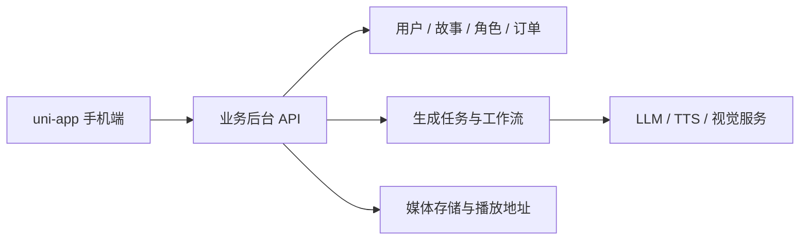

# 我的传说 v0.2.0 接入补充

2026-10-15：目前交付为前端原型，本节均为客户端拟采用的契约，不代表任何已有服务端已实现。

新增端点集中在 `src/services/api.ts`：

| 操作 | 客户端拟采用的接口 | 结果 |
|---|---|---|
| 作品详情 | GET /stories/{id} | Story，包含 chapters 与可选 media |
| 编辑草稿 | POST /stories/{id} | Story |
| 开始生成 | POST /stories/{id}/generation-tasks | GenerationTask |
| 查看生成任务 | GET /generation-tasks/{id} | 任务状态、进度、错误说明 |

开始生成应由服务端提供幂等与归属验证，任务离开页面后继续运行，客户端轮询暂定每 900ms。正式接入时按后端限流改为合理间隔、退避或订阅。章节正文通过作品详情返回，示例内容仅出现在本地模式。

`PerformanceMedia` 包含 `posterUrl`、可选 `videoUrl`、`duration`、actors 和 cues；cue 使用 `speakerId/start/end/text`。媒体就绪后由实际播放时间驱动字幕与角色；不得把模型预计时长当成实际视频长度。当前 H5 有静态场景时间轴演示和真实 video 组件两个分支，后者未经过实际媒体验收。

旧草稿继续使用 `zj-shell:demo-stories:v1`，读取时补充新增示例，绝不覆盖同 ID 的用户内容。会员与订单在前端仅展示预览/空态，未接支付。商城体验兑换数据位于独立 `my-legend:demo-wallet:v1`，不作为真实权益凭证。

微信小程序目前只验证编译；现有约 10 MB 插画资源需要在发布前完成体积处理与域名配置。App 资源需进一步使用自己的应用标识、签名和打包环境产出 APK。真实协议、账号、媒体与支付分别验收。

---

# 我的传说后续功能接入说明

日期：2026-10-14；对应 App 0.1.0。

本文是 App 壳子与后续服务的接入方案。当前验证范围是本地演示和编译，不是现有后台的能力认定。尚未配置任何真实后台地址，也没有调用模型、短信、支付或语音服务。

## 1. 应用和后台各自负责什么

App 负责页面、输入、路由、会话管理、任务进度展示和媒体播放。业务后台负责认证、数据归属、会员与余额、生成任务、订单和权益。AI 编排、LLM、TTS、ASR 与视觉引擎位于后台之后，由后台调用。



App 不直接携带模型密钥，不凭页面中的价格计算实际扣款，也不把客户端传来的 userId 当成故事归属的可信依据。后台从认证会话取得用户身份。

如果已经有 Java/若依业务后台或 Python/LangGraph 服务，可以在业务后台新增适配接口，也可以在 `src/services/api.ts` 映射现有接口。无需为了手机端重新建设一套用户和故事系统；先明确各模块的实际数据来源和授权边界。

## 2. 壳子已写好的接口契约

API 根地址由 `VITE_API_BASE_URL` 配置，建议包含 `/api/v1`。登录以外的请求通过 `Authorization: Bearer <accessToken>` 认证。

当前客户端约定统一响应：

```json
{
  "code": 0,
  "message": "ok",
  "data": {},
  "requestId": "可选的服务端追踪标识"
}
```

HTTP 非 2xx 和 `code` 非 0 都会被当成失败。HTTP 401 或业务 `code:401` 会清除会话并回到登录页；登录接口的 401 显示账号错误。当前不实现自动刷新 Token，到期后重新登录。后续如增加刷新机制，需要单独处理并发刷新、撤销和失败回退。

| 端点 | 输入 | `data` 输出 | 对应页面 | 客户端状态 |
| --- | --- | --- | --- | --- |
| `POST /auth/login` | `account,password,inviteCode?` | `accessToken,expiresIn,user` | 登录 | 已实现真实请求适配，未联调 |
| `POST /auth/logout` | 空对象 | `null` | 我的 | 已实现，失败时也退出本机 |
| `GET /home` | 无 | `user,latestStory`，无故事时 `latestStory:null` | 首页 / 我的 | 已实现适配，未联调 |
| `GET /stories` | 无 | `Story[]` | 故事列表 | 已实现适配；分页待扩展 |
| `POST /stories` | `title,genre,idea` | 新建的 `Story`，状态 `draft` | 创作 | 本地保存可用；真实接口未联调 |
| `GET /characters` | 无 | `Character[]` | 角色 | 已实现适配，未联调 |
| `GET /shop/products` | 无 | `Product[]` | 商城 | 已实现适配，未联调 |

`User` 包含 `id,displayName,avatarUrl,vipDays,balance`。会员天数和余额由后台返回。

`Story` 包含 `id,title,genre,idea,status,progress,chapter,coverUrl,createdAt`。`status` 为 `draft / generating / ready / failed`，`progress` 约定为 0—100 的界面进度，`createdAt` 为 ISO 8601 字符串。后续应拆分阅读位置和制作任务进度，避免用一个百分比同时表示两种含义。当前 42% 是原型演示值，没有生成任务作为来源。

`Character` 包含 `id,name,description,avatarUrl,owned`。`Product` 包含 `id,name,description,imageUrl,price,currency`；当前商品使用 `coins`，尚无订单和扣款逻辑。

字段定义以 `src/types/domain.ts` 为准。列表接口当前要求返回数组；如已有后台返回分页对象，需要在 `api.ts` 提取列表，并在下一阶段增加游标/分页与列表加载状态。远程素材需要返回手机可访问的 HTTPS 地址；客户端无权访问后台本地磁盘路径。

## 3. 第一阶段：认证、资料和云端草稿

先接账号认证、登录退出、用户资料、首页汇总和故事 CRUD。完成后能从手机登录真实账号、保存草稿，再在另一台设备打开同一草稿。

已有账号登录、手机号验证码、注册、找回密码属于不同流程。验证码服务需提供发送、冷却、验证与风控；不要只在前端显示一个倒计时。协议页面和同意记录需固定协议版本、时间和用户，当前壳子的占位文案不能作为正式协议。

先联调当前 7 个端点，再添加故事详情、编辑、分页。保存时通过版本号或其他并发机制避免后一次设备编辑覆盖另一台设备的内容。

验收至少包含：有效登录、错误密码、401、退出后台撤销、跨用户数据隔离、另一设备读取同一草稿、断网失败提示、重复点击只保存一次。

## 4. 第二阶段：AI 故事生成与续写

生成应采用后台异步任务，避免一次 HTTP 请求一直等待整篇内容生成。

建议新增以下接口；当前壳子尚未调用它们：

| 接口 | 用途 |
| --- | --- |
| `POST /stories/{storyId}/generation-jobs` | 创建生成/续写任务，返回 `jobId` |
| `GET /generation-jobs/{jobId}` | 查询 `queued/running/succeeded/failed/cancelled`、阶段、进度和可读错误 |
| `POST /generation-jobs/{jobId}/cancel` | 请求取消；以后台最终状态为准 |
| `GET /stories/{storyId}/chapters` | 获取已完成并可展示的章节 |
| `GET /stories/{storyId}/chapters/{chapterId}` | 章节正文与引用的角色、版本 |

提交任务使用一次操作稳定的幂等标识，重复点击或网络重试不能重复创建收费任务。完成后返回 `storyId / chapterId / contentVersion`，让 App 按已生成版本读取正文。

手机端第一版可每 2—3 秒查询任务状态；离开页面停止界面轮询，后台任务继续运行，返回页面后重新查询。只有终态成功且产物可读取才显示完成，不将“请求已接收”当成内容已生成。持续失败保留错误和任务 ID，提供明确的重试入口。后续再按实际需要替换为 WebSocket 或平台兼容的消息通道。

接入现有 LangGraph/故事工作流时，由后台把其 task/run ID 映射为统一 `jobId`。App 不需要理解工作流节点名、模型参数或内部路径，也不应接收模型服务密钥。

## 5. 第三阶段：角色、伴读和音频

角色先接可用角色、权益与绑定；选择角色后把角色稳定 ID 与故事草稿关联。若涉及 NFC 玩具/硬件角色获取，需要另行确认 Android/iOS 支持、读卡插件与后台绑定接口，当前没有启用 NFC 插件。

伴读先接“已确认章节 → 生成音频任务 → 返回可播放的媒体地址 → App 播放”。可使用 `uni.createInnerAudioContext` 管理播放、暂停、进度和错误；页面销毁时释放对象，是否后台播放另行设计。

建议 `POST /stories/{id}/audio-jobs` 创建任务，再查询任务和媒体结果。音频返回时长、版本、角色音色引用和有效播放地址，分句或字幕还要提供时间信息。需要同步演绎时使用同一版本的故事、音频与时间轴，不能用“预计五分钟”代替真实媒体时长。

实时对话再增加用户主动触发的录音、ASR、对话和 TTS 流程，届时才启用必要的麦克风权限。当前 AI 伴读按钮是入口说明，不会录音。

## 6. 第四阶段：会员、余额、商城和订单

先接商品和用户权益，再接订单与支付。建议流程：商品 SKU → 服务端创建订单 → 发起目标平台支付 → 服务端核验平台回调 → 查询订单成功 → 服务端发放权益 → 刷新角色与余额。

客户端支付回调不能直接视为发货依据。价格、余额、扣款、退款和权益归属都由后台决定；用订单幂等避免重复扣款或发放。灵感币购买和现金充值也应分开管理。

当前商城只展示样例，不创建订单、不扣除演示余额。Android/iOS 的支付方案需结合实际发行渠道确认后再接插件。

## 7. 手机部署与联调

- 手机上的 `localhost` 指向手机自身；后台必须使用手机可访问的域名或局域网地址。
- H5 联调需要服务端 CORS 或开发代理；App 联调保持 HTTPS 与证书验证。
- 若以后发行小程序，需要配置该平台的请求域名白名单，并核对 SVG、字体和插件支持；当前只配置和编译 H5/App。
- App 发布前使用自己的 AppID、包名、签名与图标；当前仅产出未签名的编译资源。
- 每接一项能力，在真实服务和手机上验证成功、失败、断网与重复操作，再更新能力状态。

官方参考：[Vue 3 CLI 工程](https://uniapp.dcloud.net.cn/quickstart-cli)、[uni.request 请求说明](https://uniapp.dcloud.io/api/request/request)、[HBuilderX 入门与 App 打包](https://uniapp.dcloud.net.cn/quickstart-hx.html)。
